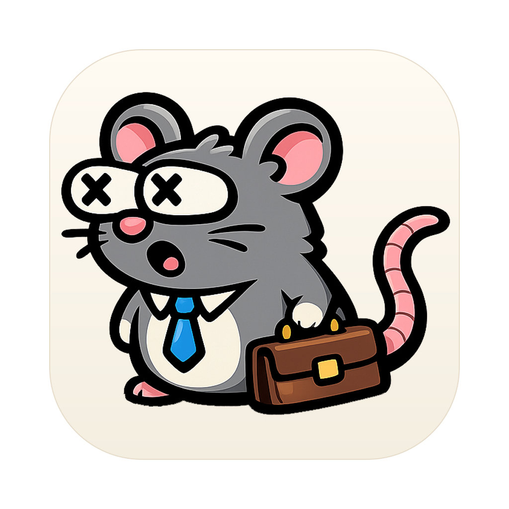
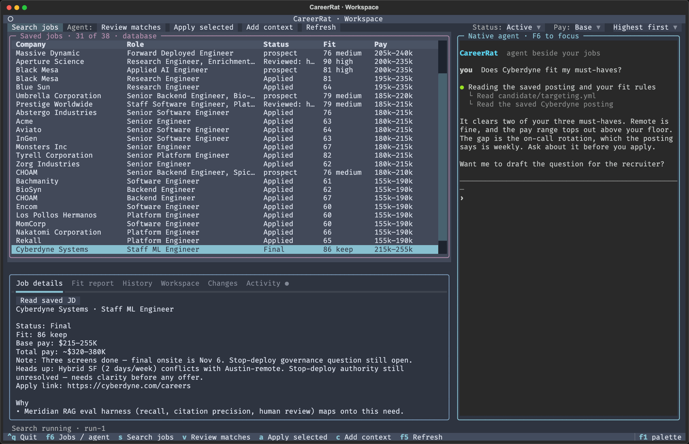
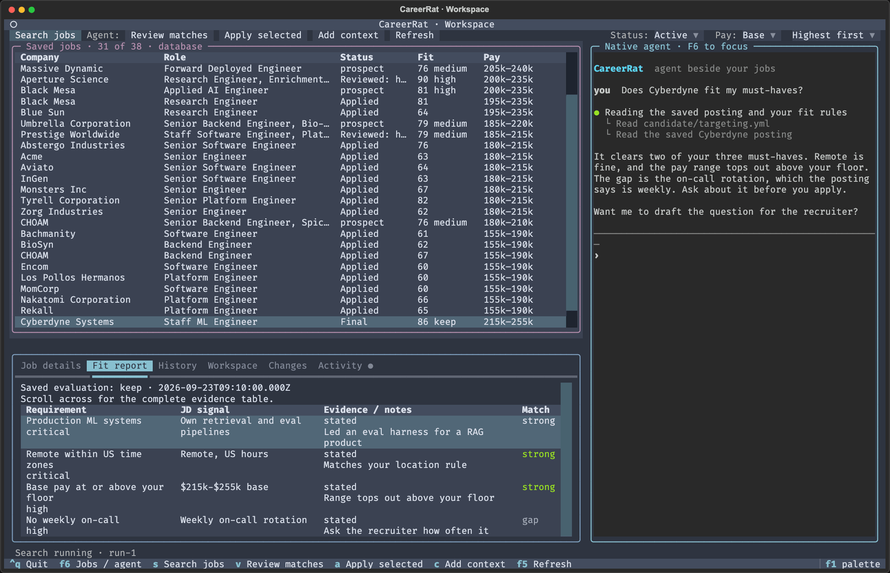
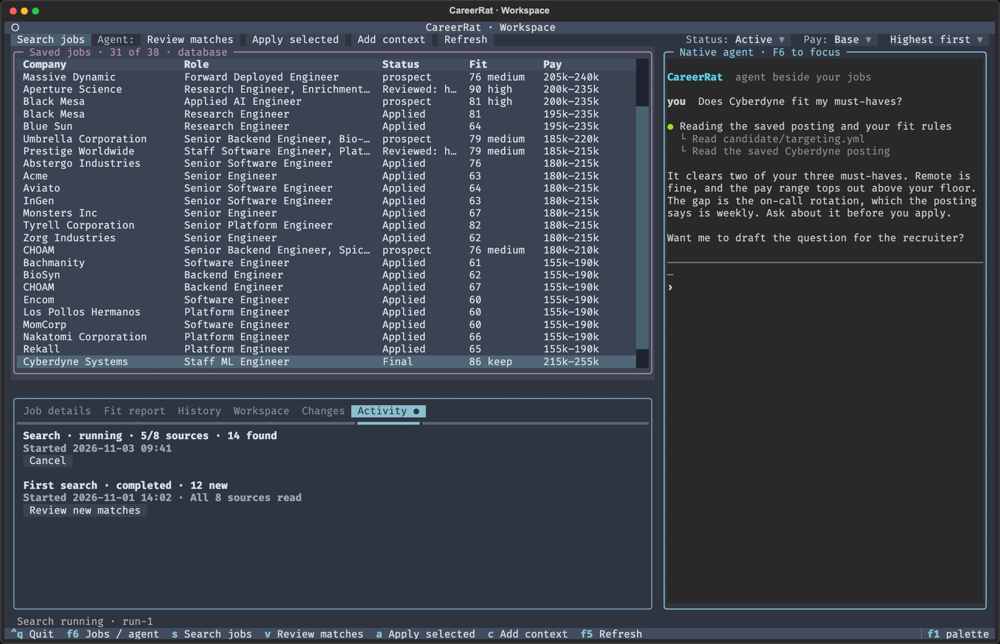

<div align="center">



<h1>CareerRat</h1>

**Turns the AI CLI you already have into a personal recruiter.**

</div>

<p align="center">
  <a href="https://www.npmjs.com/package/careerrat"></a>
  <a href="LICENSE"></a>
  <br>
  <a href="https://github.com/CodesWhat/careerrat/actions/workflows/ci-verify.yml"></a>
  <a href="https://securityscorecards.dev/viewer/?uri=github.com/CodesWhat/careerrat"></a>
  <a href="https://codecov.io/gh/CodesWhat/careerrat/tree/dev%2Fv0.23"></a>
  <br>
  <a href="https://www.npmjs.com/package/careerrat"></a>
</p>

<p align="center"><small>CareerRat itself costs nothing. Your AI provider may have its own plan or usage costs.</small></p>

<hr>

<h2 align="center">Contents</h2>

- [Current Status](#current-status)
- [Documentation](#documentation)
- [Quick Start](#quick-start)
- [Recent Updates](#recent-updates)
- [Why CareerRat](#why-careerrat)
- [Features](#features)
- [Supported Integrations](#supported-integrations)
- [Star History](#star-history)
- [Built With](#built-with)
- [For Developers](#for-developers)
- [Community & Support](#community-support)

<hr>

<h2 align="center" id="current-status">Current Status</h2>

**As of November 3, 2026:** v0.24.0 is the latest release. CareerRat installs
from npm and runs on your machine, in your terminal, with the AI CLI you already
use. v0.19.2 was the last release with a Mac app.

New in v0.24.0:

- An Activity tab shows background searches as they run, and Search jobs starts
  one straight away.
- Generated résumés, cover letters and AI-drafted packet answers are fact-checked.
  Review saved and deterministic answers yourself. One-off chat answers aren't
  automatically checked. Eligible cover-letter and answer drafts may get a wording
  review when it's enabled in `modes.yml` and available. Deterministic answers are
  excluded; a failed review leaves the draft unchanged.
- Honest outcome rates, fake-recruiter warnings, and your corrections saved as
  writing rules.
- Prebuilt terminal helpers cover supported Linux architectures. Other platforms
  may need native build tools.

New in v0.23.0:

- `careerrat start` now opens the terminal workspace.
- Run it for other people with `--for <name>`. Each person gets their own
  separate workspace.
- Much better job search: more sources, related job titles, dead job boards
  skipped, and closed jobs detected.
- The agent never presses Submit unless CareerRat's checks pass first.
- Send a roundup to the people you run it for, once they've agreed to get one.
- Needs Node 24.22.1 or newer and Python 3.11 or newer.

Automatic submission, introduced in v0.21.0:

- CareerRat submits an application itself once it's complete and checked: every
  required field answered, required uploads attached, one clear submit button,
  and a fit gate of KEEP or a REVIEW you approved. It presses Submit once and
  looks for a confirmation page.
- `careerrat automation submit manual --write` turns that off, so CareerRat
  fills the form and you press Submit.
- If no confirmation page shows up, the application isn't marked Applied and
  CareerRat never clicks again. Today asks you to check the site.
- When CareerRat stops before Submit, it says why. The job thread shows what
  was sent.

If you use the Mac app, it keeps working at v0.19.2. There won't be a later Mac
build; switch with `npm i -g careerrat`.

<hr>

<h2 align="center" id="documentation">Documentation</h2>

| Resource | Link |
| --- | --- |
| Website | [careerrat.com](https://careerrat.com/) |
| Docs | [careerrat.com/docs](https://careerrat.com/docs) |
| Changelog | [`CHANGELOG.md`](CHANGELOG.md) |
| Architecture | [`docs/ARCHITECTURE.md`](docs/ARCHITECTURE.md) |
| Release process | [`docs/RELEASE.md`](docs/RELEASE.md) |
| Windows status | [`docs/WINDOWS.md`](docs/WINDOWS.md) |
| Contributing convention | [`AGENTS.md`](AGENTS.md) |
| Security policy | [`.github/SECURITY.md`](.github/SECURITY.md) |
| Issues | [GitHub Issues](https://github.com/CodesWhat/careerrat/issues) |
| Discussions | [GitHub Discussions](https://github.com/CodesWhat/careerrat/discussions) |
| Real-time chat | [CodesWhat Discord](https://discord.gg/mWHCPJRzSx) |

<hr>

<h2 align="center" id="quick-start">Quick Start</h2>

CareerRat installs from npm. It hands the actual work to an AI coding assistant
you probably already have on your machine, Claude Code or OpenAI Codex, and
gives that assistant a full recruiter's job to do: read the posting, check it
against what you want, write your materials, and keep score of everything.

CareerRat needs one AI engine to do the actual work: [Claude Code](https://docs.anthropic.com/en/docs/claude-code/overview)
2.1.241 or newer, or [OpenAI Codex](https://developers.openai.com/codex/cli/)
(any version). You do not need it before you install CareerRat. If neither is
there, CareerRat can install Claude Code for you on first run, or point you at
the Codex setup guide. CareerRat detects which one is ready on your machine and
you pick it.

### Install

You need Node.js 24.22.1 or newer within 24.x, or 26.12.1 or newer, and
Python 3.11 or newer (with `venv`, which
some Linux systems package separately, for example `python3-venv`). On Debian or
Ubuntu: `sudo apt install python3 python3-venv`. The terminal helper ships
prebuilt for supported macOS, Linux (x64, arm64, glibc and musl) and Windows
architectures. If a prebuild is missing or cannot load, installation falls back
to `node-gyp rebuild` and needs native build tools.

```bash
npm i -g careerrat
careerrat start
```

`careerrat start` opens the CareerRat workspace in your terminal. The Mac app
and the browser workspace are being retired.

The Mac app ended at v0.19.2 and is no longer updated. The `.dmg` and the
Homebrew cask are frozen at that version, so install from npm.

CareerRat works with [Claude Code](https://docs.anthropic.com/en/docs/claude-code/overview)
or [OpenAI Codex](https://developers.openai.com/codex/cli/). Install and sign
in to either one, then pick it in CareerRat. CareerRat keeps using the one
you picked. It never falls back to another tool or switches on its own. It
shows `Ready` once the tool is installed, signed in, and passes a quick check.

### First run

Run `careerrat start` in a terminal window. The first time, CareerRat sets up a
private Python environment for the workspace, which takes a minute and needs an
internet connection. It never touches your other Python packages. After that it
opens right away.

The workspace shows your saved jobs on one side and a chat with Claude Code or
Codex on the other. CareerRat uses whichever one it finds on your machine, Claude
Code first. If neither is installed, the workspace still opens and tells you so.
[Claude Code](https://docs.anthropic.com/en/docs/claude-code/overview) needs a
paid Claude plan; Pro is enough, and Max gives more usage. You can
[get Claude through Scott's referral](https://claude.ai/referral/rOLHwxlsfA).
To use Codex, follow its [official install guide](https://developers.openai.com/codex/cli/).
To pick one yourself, run `careerrat start claude` or `careerrat start codex`.

On a brand new install, the chat starts on setup by itself. Drop a PDF, DOCX,
image, or text resume into the conversation, or just start talking. Paul, the
CareerRat rat, learns your target roles, location rules, compensation floor,
dealbreakers, evidence, and honesty boundaries, and speaks in plain English. When
it needs an abstract choice, it gives concrete examples instead of job-search
jargon. For example:

> "What would make one job worth applying to before another? The kind of work,
> a schedule and pay that fit, or room to grow?"

Progress saves continuously. Once the minimum search profile is ready, CareerRat
starts the first location-aware search while the rest of setup continues.

From there, ask it to find roles, evaluate a posting, tailor an application,
prepare an interview, or pick up a saved thread. Click a job to see its details,
Search jobs starts a background search directly. Review and Apply insert a
request into the chat for you to send.
Press F6 to move between the jobs and the chat, and Ctrl+Q to quit. Use
`careerrat start --no-agent` to browse saved jobs without starting a chat.

`careerrat start` needs a real terminal window. It will not run from a script or
a pipe.

### What it looks like

`careerrat start` opens your saved jobs on the left and your agent on the right.
Pick a job and the details, a requirement-by-requirement fit report, its history,
and the changes you've made appear under the table. These screenshots use demo
jobs and a stand-in agent transcript.



The Fit report checks the posting against your must-haves:



Search jobs runs in the background, and the Activity tab shows its progress while
you keep working:



<details>
<summary>Windows</summary>

The Windows x64 installer passed build, install, launch, export, and uninstall
QA. A public Windows installer will ship only after SignPath Foundation signing
is available; SignPath requires project reputation CareerRat does not yet have.
See [Windows status](docs/WINDOWS.md).

There is no mobile app and no Intel Mac build.

</details>

<hr>

<h2 align="center" id="recent-updates">Recent Updates</h2>

<details open>
<summary><strong>v0.24.0 highlights</strong></summary>

- The terminal workspace has an Activity tab. Search jobs runs in the background
  and shows its progress there.
- Saved résumés and cover letters are fact-checked. One-off chat answers are not
  automatically checked.
- Honest outcome rates and fake-recruiter warnings.
- Prebuilt terminal helpers cover supported Linux architectures. Other platforms
  may need native build tools.
- CareerRat ships through npm only. The Mac app ended at v0.19.2.

Full history in [CHANGELOG.md](CHANGELOG.md).

</details>

<hr>

<h2 align="center" id="why-careerrat">Why CareerRat</h2>

**Rate. Apply. Track.**

CareerRat reads the full job posting against your location and compensation floor,
fit, and dealbreakers before it recommends anything. It builds resumes, cover
letters, and screening answers from your real experience, then fills supported
application forms. When the application is complete and verified, CareerRat
submits it. Run `careerrat automation submit manual --write` (or ask the agent to)
and it stops for you to press Submit instead.

Pay rules work for salaried, hourly, tipped, and commissioned jobs. You can set a
guaranteed base floor, a minimum for annual cash earnings that includes wages,
tips, commission, and cash bonuses, or both. Equity and benefits never count as
cash earnings.

The search stays together in one local workspace: conversations, jobs, recruiter
threads, missions, files, follow-ups, interviews, and outcomes. You can close the
terminal, come back later, and CareerRat restores the relevant state without
depending on one AI vendor's session history. CareerRat owns those workflows and
threads, so the execution layer stays provider-neutral.

<hr>

<h2 align="center" id="features">Features</h2>

### Rate every posting before you apply

CareerRat combines built-in public job-board and ATS sources with broad AI
open-web discovery. Source setup selects the applicable built-in sources from
your saved roles, then CareerRat discovers additional specialist boards and
employer pages for that search.

CareerRat gives Claude Code and Codex the same complete workflow, keeps long
searches and application missions durable across navigation and restart, and
turns finite questions into normal clickable choices that can also be answered
in text. Search combines built-in boards with AI open-web discovery, keeps AI
leads clearly unverified, then checks readable full postings against location,
office-day, compensation, seniority, eligibility, and fit rules before treating
them as verified.

The terminal search worker skips browser-backed saved searches and does not
open a login window for them. Public sources and AI open-web discovery can
still run. Ask the agent to research login-gated sites separately.

Those partial discoveries are not presented as proven jobs. Search labels them
**AI · unverified** and preserves the visible title, company, location, pay,
date, link, and search evidence. **Evaluate** then verifies liveness, captures
the full posting through the public or supervised browser path, and applies your
real location, compensation, eligibility, and fit rules before any tailoring or
application work begins.

### It only submits when the application is complete

- Every job is read in full before tailoring or application work begins.
- Generated claims must trace back to your own evidence. Missing facts are asked
  for or left out, never invented.
- Application automation fills safe, confirmed fields and can attach the
  generated resume. When an application needs your answer, the job thread shows
  that question in its review panel and saves the response against the exact
  form question before preparation resumes. Voluntary demographic and
  self-identification questions stay blank by default; in
  **Profile > Application defaults**, you can leave them blank or choose the
  form's decline option when one is available. CareerRat never infers an answer.
- Application questions stay with the exact job thread. CareerRat can prepare a
  form through the final safe step. CAPTCHA, sensitive attestations, and
  uncertainty always stop it and hand the form to you. By default (`submit: auto`
  in `automation.yml`) CareerRat presses Submit itself, once, only when every
  required field is answered, required uploads are attached, exactly one clearly
  labelled submit control exists, and the fit gate is KEEP or a REVIEW you
  approved. It then waits for a confirmation page. If it doesn't see one, the
  application is marked submitted-unverified, never retried, and you're asked to
  check the site. Run `careerrat automation submit manual --write` and CareerRat
  fills the form and stops for you to press Submit.

### One workspace for the whole search

The terminal workspace has three working areas. The saved jobs table is on the
left, with status, fit and pay, and filters for status and pay. Your Claude Code
or Codex agent is on the right, so job-search actions and skill results come
back to the same chat. Under the table, the Inspector has tabs for Job details,
the Fit report, History, Workspace, Changes, and Activity.

Missions turn longer work into resumable, ordered steps with clear user gates.
Deep ingest gets its own durable thread, and mock interviews keep their session
and debrief. Changes records supported settings and evidence edits, with a preview-first
Undo for each recorded change.

Searches continue in the background when you move between tabs. Activity shows
their progress. If CareerRat or your computer stops mid-run, the saved run shows
the interruption. Use Search jobs to retry with another search.

CareerRat stores canonical candidate state, conversations, missions, mock
sessions, and pipeline records in local SQLite. Job descriptions, research,
interview dossiers, resumes, and exports remain readable Markdown, PDF, or other
normal files. See the [chat-first runtime](docs/CHAT_FIRST_RUNTIME.md).

### Your data stays on your machine

CareerRat has no product account, hosted candidate database, or app telemetry.
Your workspace stays on your machine and can be exported.

<details>
<summary>Exactly what leaves your machine</summary>

- The selected AI CLI connects to its own provider under that provider's account
  and privacy terms.
- Search, research, and browser skills fetch the public or authenticated pages
  needed for the task you started.
- The Mac app (final release v0.19.2, no longer updated) checked GitHub's `latest-mac.yml` SHA-512 checksum metadata at most
  once a day. It sends no candidate data and no unique installation or device
  identifier. When a newer version exists, it downloads the signed and notarized
  app update. Nothing installs until you choose **Restart and install**.
  Automatic checks can be disabled in Settings, and "Check for Updates…" still
  works as a manual check-and-download action. Windows self-update stays off
  until its installed app and final installer share a complete signing chain.
- The public website uses cookieless, privacy-limited aggregate analytics. The
  local app does not load that website analytics client.

Read the full [privacy documentation](https://careerrat.com/docs/advanced/privacy),
[data contract](docs/DATA_CONTRACT.md), and [Code signing policy](docs/CODE_SIGNING_POLICY.md).

</details>

### 28 skills, one workflow

The terminal workspace and the CLI share the same public skill definitions. You never
have to know their names; Paul routes to the right one for what you ask.

<details>
<summary><strong>Setup and intake</strong></summary>

- `ingest-profile`: conversational candidate setup and resume intake
- `resume-extract`: structured facts from PDF, image, or DOCX resumes
- `intake-extract`: verbatim extraction from general dropped files
- `configure`: inspect and change validated CareerRat settings

</details>

<details>
<summary><strong>Find and research</strong></summary>

- `setup-searches`: turn targeting into a reviewed source configuration
- `search-jobs`: search configured sources, dedupe, check liveness, and triage
- `discover-companies`: find likely employers and resolve their career boards
- `research-boards`: find and validate additional job boards
- `research-company`: build a cited company brief
- `research-comp`: benchmark compensation for a role and location
- `company-health`: assess role-specific company stability and momentum
- `relationship-sourcing`: find recruiters, hiring teams, and warm contacts

</details>

<details>
<summary><strong>Evaluate and apply</strong></summary>

- `evaluate-job`: full-posting fit, compensation, location, and action gate
- `coach-gaps`: turn review-worthy fit gaps into an honest plan
- `tailor-application`: produce evidence-backed resumes and application artifacts
- `answer-question`: answer screening questions from saved evidence and defaults
- `apply-job`: orchestrate evaluation, artifacts, form filling, and user review
- `optimize-linkedin`: propose evidence-backed LinkedIn profile improvements

</details>

<details>
<summary><strong>Pipeline and communication</strong></summary>

- `email-comms`: draft and track recruiter and hiring-team messages
- `schedule-meeting`: handle scheduling threads and availability replies
- `calendar-sync`: write approved search events to supported calendars
- `ingest-mail`: fold recruiter and application email into the workspace
- `ingest-messages`: capture LinkedIn and Wellfound message threads
- `sync-status`: read ATS dashboards and normalize application status
- `track-outcomes`: record transitions, rejections, advances, and learnings

</details>

<details>
<summary><strong>Interview, strategy, and support</strong></summary>

- `interview-prep`: create interview packets, practice, and debriefs
- `reevaluate-strategy`: tune the search from accumulated funnel outcomes
- `report-issue`: diagnose CareerRat failures and prepare redacted reports

</details>

<hr>

<h2 align="center" id="supported-integrations">Supported Integrations</h2>

### AI runtimes

[Claude Code](https://docs.anthropic.com/en/docs/claude-code/overview) and
[OpenAI Codex](https://developers.openai.com/codex/cli/) are CareerRat's two
supported runtime choices. The AI controls use the same product language for
either one. **Automatic** chooses by task, keeping Paul on the strongest coaching
path while routine search and extraction work stays efficient. **Faster**,
**Balanced**, and **Best** let you choose the overall quality level, while
**Thinking depth** controls how long the selected runtime reasons. The setting
never ranks Claude Code against OpenAI Codex or silently changes providers.

### Job sources (22 built-in, plus open-web discovery)

**Aggregators:** HiringCafe, LinkedIn, Indeed, Glassdoor, Wellfound, Remote Vibe
Coding Jobs

**ATS boards:** Ashby, Greenhouse, Lever, Workable, SmartRecruiters, Recruitee,
Workday

**Remote boards:** RemoteOK, Jobicy, Working Nomads, We Work Remotely, Remotive

**Hospitality boards:** OysterLink, Hcareers, Hospitality Online, iHireHospitality

Anything not covered by a built-in source is filled in by AI open-web discovery,
kept clearly labeled **AI · unverified** until Evaluate reads the live posting.
See [docs/SOURCES.md](docs/SOURCES.md) for the full, current source table.

### Calendar and messages

Approved interview holds, prep blocks, and deadlines write to Apple Calendar,
Google Calendar, or Outlook. Recruiter email and LinkedIn or Wellfound message
threads fold into the same workspace as the rest of your search.

<hr>

<h2 align="center" id="star-history">Star History</h2>

<div align="center">
  <a href="https://www.star-history.com/?repos=codeswhat%2Fcareerrat&type=date&legend=top-left">
    <picture>
      <source media="(prefers-color-scheme: dark)" srcset="https://api.star-history.com/chart?repos=codeswhat/careerrat&type=date&legend=top-left&theme=dark" />
      <source media="(prefers-color-scheme: light)" srcset="https://api.star-history.com/chart?repos=codeswhat/careerrat&type=date&legend=top-left" />
      
    </picture>
  </a>
</div>

<hr>

<div align="center">

<h2 align="center" id="built-with">Built With</h2>

[](https://nodejs.org/)
[](https://textual.textualize.io/)
[](https://react.dev/)
[](https://vite.dev/)
[](https://biomejs.dev/)
[](https://www.sqlite.org/)
[](https://claude.ai/)
[](https://openai.com)

[](https://semver.org/)
[](https://www.conventionalcommits.org/)
[](https://keepachangelog.com/)

</div>

<hr>

<h2 align="center" id="for-developers">For Developers</h2>

CareerRat ships as an npm package. The `careerrat` CLI runs the engine and the
terminal workspace, on the same canonical skills and local data.

### Install from npm

Needs Node.js 24.22.1 or newer within 24.x, or 26.12.1 or newer, and Python
3.11 or newer. The terminal helper
uses a prebuild when one is available and compatible; otherwise installation
needs native build tools.

```bash
npm i -g careerrat
careerrat start
```

`careerrat start` and `careerrat tui` are the same command: they open the
terminal workspace. `careerrat start claude` or `careerrat start codex` picks the
agent, and `--no-agent` skips it. `careerrat start --browser` still serves the
legacy browser workspace (with `--no-open` and `--port`) until it is removed.

Useful terminal commands:

```bash
careerrat next          # show the next useful agent-led workflow
careerrat doctor        # verify setup, data, skills, and runtime health
careerrat update        # update an npm installation without touching user data
careerrat tracker       # write a recovery snapshot and summary
careerrat tracker-dev   # legacy: serve the browser workspace at localhost:7777
```

### Textual workspace

`careerrat start` (also `careerrat tui`) opens clickable saved jobs, details, requirement reports and
history beside native agent chat. Use `--agent claude` or `--agent codex` to
choose the agent, or `--no-agent` to browse saved jobs. Keys: F6 switches
between jobs and agent, `s` starts a background search, `v` reviews matches, `a`
applies to the selected job, `c` adds context, F5 refreshes, F1 opens the command
palette, Ctrl+J adds a new line in the agent, and Ctrl+Q closes the workspace
and its agent. Shift+Enter also adds a new line in terminals that distinguish it
from Enter; other terminals may submit the prompt. The full tour is in
[The terminal workspace](https://careerrat.com/docs/getting-started/terminal-workspace).

First launch needs Python 3.11 or newer with venv support. On Windows it looks
for the `py -3` launcher, then `python`. The native terminal dependency has
prebuilds for supported macOS, Linux and Windows architectures. A missing or
incompatible prebuild needs native build tools; `careerrat doctor` reports when
the helper is missing. CareerRat installs
hash-locked Textual dependencies in a private environment. `careerrat tui setup`
prepares it ahead of time; `CAREERRAT_TUI_PYTHON` selects a Python interpreter.
Your global Python packages and candidate data stay separate from that runtime.

Search jobs starts the background worker directly. Review and Apply insert a
request into the agent; review it and press Enter there to run it. Add context saves pasted documents or local files before
generating its request. Read saved JD opens the captured posting locally.
Windows is untested end to end so far.

### Build from source

```bash
git clone https://github.com/CodesWhat/careerrat
cd careerrat
npm install
npm run hooks:install
npm link
careerrat start claude
```

The repository convention is in [AGENTS.md](AGENTS.md). Public architecture and
release documentation live in [docs/ARCHITECTURE.md](docs/ARCHITECTURE.md) and
[docs/RELEASE.md](docs/RELEASE.md). Full setup docs are on
[careerrat.com/docs](https://careerrat.com/docs).

<hr>

<div align="center">

<h2 align="center" id="community-support">Community & Support</h2>

Real-time chat and early support: **[CodesWhat Discord](https://discord.gg/mWHCPJRzSx)**

Bugs and concrete feature requests go to **[GitHub Issues](https://github.com/CodesWhat/careerrat/issues)**; open-ended questions, ideas, and show-and-tell go to **[GitHub Discussions](https://github.com/CodesWhat/careerrat/discussions)**; real-time chat happens on the **[CodesWhat Discord](https://discord.gg/mWHCPJRzSx)**.

Found a bug in the app itself? Say so in your CareerRat chat. It prepares
redacted diagnostics (never candidate PII, comp, or workspace contents) and
only opens a GitHub issue with your explicit yes.

Private vulnerability reports: [Security policy](.github/SECURITY.md).

---

**[MIT License](LICENSE)**

<a href="https://codeswhat.com">
  
</a>

[CodesWhat](https://codeswhat.com), small, sharp tools from one developer and a lot of agents.

<a href="#careerrat">Back to top</a>

</div>
</content>
