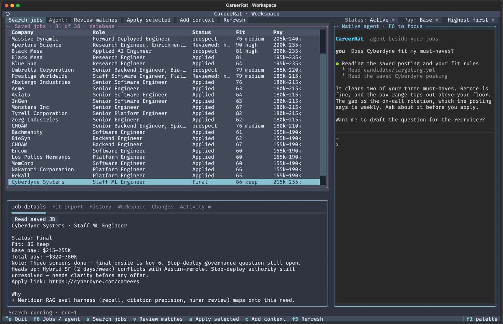
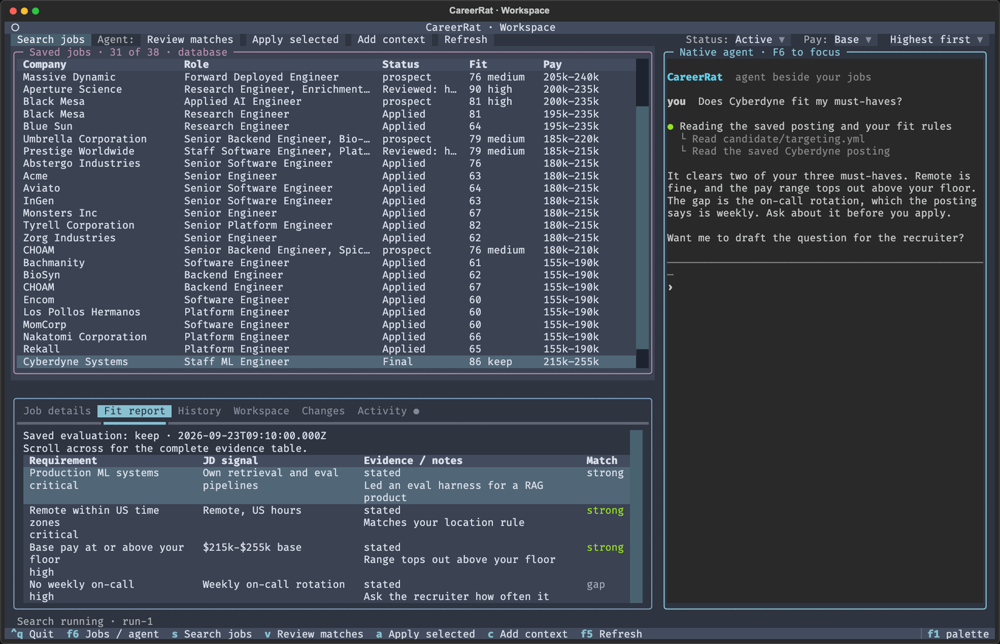
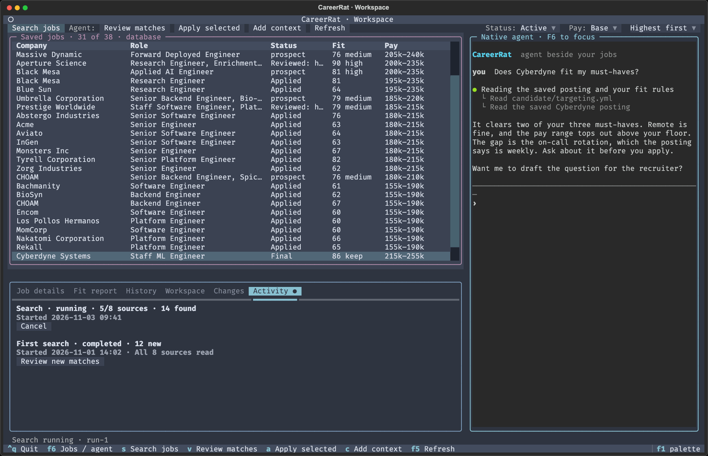
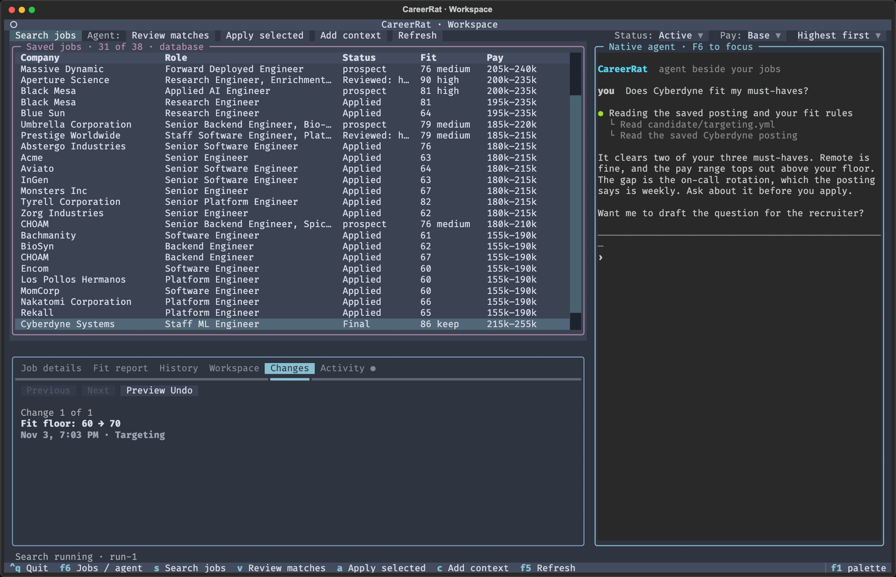

`careerrat start` opens the terminal workspace. Your saved jobs sit on the left,
your Claude Code or Codex agent sits on the right, and the details for the job
you picked sit under the table. It reads the same local workspace the CLI and
skills use, so nothing here is a second copy of your data.



The screenshots on this page use demo jobs from a throwaway workspace. The agent
text is a stand-in transcript, not a real session.

## Starting it

```bash
careerrat start            # pick the agent it finds, Claude Code first
careerrat start claude     # or: careerrat start codex
careerrat start --no-agent # browse saved jobs without a chat
```

It needs a real terminal window. The first run sets up a private Python
environment, which takes about a minute. After that it opens right away.

## The three areas

- **Saved jobs** is the table at the top left: company, role, status, fit, and
  pay. Click a row, or move with the arrow keys, to pick a job. The dropdowns on
  the right of the toolbar filter by status (Active or All statuses), set the pay
  basis, and sort by pay.
- **The agent** is the native Claude Code or Codex session on the right. It is
  the real tool, running beside your jobs. Review and Apply put a request in
  the agent's input, and you press Enter there to send it. Search jobs starts a
  background worker directly.
- **The Inspector** sits under the table. Its tabs show what CareerRat knows
  about the selected job and what is happening in the background.

## The Inspector tabs

| Tab | What it shows |
| --- | --- |
| Job details | Status, fit, pay, notes, and heads-ups for the job. **Read saved JD** opens the saved posting. |
| Fit report | The requirements from the posting, the evidence from your record, and how well each one matches. |
| History | Saved job-thread messages, notes, calls and interviews tied to this job. |
| Workspace | Skill results that belong to your search as a whole, apart from any one job. |
| Changes | Edits you or the agent made to your settings, each with a preview-first Undo. |
| Activity | Background searches, with progress and a Cancel button while they run. |



## Background search

**Search jobs** starts a search of your configured sources without the agent. It
runs in the background, so you can move between tabs, read other jobs, or talk
to the agent while it works. The Activity tab shows how many sources it has
checked and how many jobs it has found so far, and a dot on the tab label shows
a search is running.



When a search finishes, **Review new matches** asks the agent to evaluate the
first five active jobs in the current view. Those may include older jobs; the
action is not limited to that search's results. If CareerRat or your computer
stops in the middle of a search, the next launch shows the interrupted run. Use
**Search jobs** to retry with another search.

## Changes and Undo

Supported settings and evidence changes are recorded in Changes with the old
and new value. Some low-level CLI writes do not create an Undo entry. Choose **Preview Undo** to see what would be
reverted, then **Confirm Undo** to apply it or **Cancel** to keep the change.



## Keys

| Key | What it does |
| --- | --- |
| F6 | Move between the jobs and the agent |
| s | Search jobs, in the background |
| v | Review matches: ask the agent to evaluate the jobs in view |
| a | Apply: ask the agent to apply to the selected job |
| c | Add context: save a posting, transcript, notes, or a file, then ask the agent to use it |
| F5 | Read the saved workspace again |
| F1 | Open the command palette |
| Ctrl+J | New line in the agent's input |
| Shift+Enter | New line when the terminal distinguishes it from Enter; otherwise it may submit |
| Ctrl+Q | Quit the workspace and its agent |

The letter keys work while the jobs table has focus. When the agent has focus,
every key goes to the agent, so press F6 first to use them. Paste outside the
agent pane to open Add context, then save the posting or file path before sending
it to the agent. Pasting into the agent pane goes straight to its input.

## The old browser workspace

Earlier releases opened a browser app at `localhost:7777`. It is legacy and is
being retired. `careerrat start --browser` and `careerrat tracker-dev` still
serve it for now, but new features land in the terminal workspace only. The Mac
app ended at v0.19.2.
